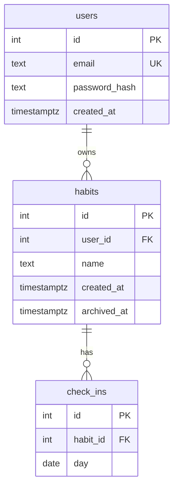

# Stamp

A full-stack habit tracker with streaks, a 26-week heatmap and weekly trends. Mark a day, and the numbers update from the database.


## Features

- Sign up and sign in with JWT authentication
- Create and archive habits
- Stamp any of the last 7 days with one click, with instant (optimistic) feedback
- Current streak, best streak and 30-day completion rate for every habit
- A 26-week heatmap of activity across all habits
- Stamps-per-week bar chart for the last 8 weeks
- Responsive layout, keyboard accessible, respects reduced-motion settings

## Tech stack

| Layer | Choice |
| --- | --- |
| Frontend | React 18, Vite, plain CSS, hand-built SVG heatmap (no chart library) |
| Backend | Node.js 16+, Express 4, `pg`, `bcryptjs`, `jsonwebtoken` |
| Database | PostgreSQL 16 with SQL migrations |
| Tooling | Docker Compose for local Postgres |

## Technical highlights

**Streaks are calculated in SQL, not JavaScript.** The query uses the gaps-and-islands technique: subtracting a `ROW_NUMBER()` window from each date gives every run of consecutive days the same group key, so current and longest streaks fall out of a single `GROUP BY`.

```sql
WITH numbered AS (
  SELECT habit_id, day,
         day - (ROW_NUMBER() OVER (PARTITION BY habit_id ORDER BY day))::int AS grp
  FROM check_ins
  WHERE habit_id = ANY($1)
),
runs AS (
  SELECT habit_id, MAX(day) AS end_day, COUNT(*)::int AS len
  FROM numbered GROUP BY habit_id, grp
)
SELECT habit_id,
       MAX(len) AS longest,
       COALESCE(MAX(len) FILTER (WHERE end_day >= $2::date - 1), 0) AS current
FROM runs GROUP BY habit_id;
```

**Other decisions worth noting**

- **Zero-activity days still show up.** The heatmap and weekly totals use `generate_series` with a `LEFT JOIN`, so empty days appear as empty cells instead of gaps.
- **Check-ins are idempotent.** `UNIQUE (habit_id, day)` plus `ON CONFLICT DO NOTHING` means a double-click or a retried request can never create a duplicate.
- **Timezone-safe dates.** `DATE` columns are returned as `YYYY-MM-DD` strings, and the browser sends its own local "today", so a streak never breaks because the server runs in a different timezone.
- **Optimistic UI.** Stamps flip immediately, then the app refetches streaks and charts so the database stays the source of truth.
- **Scoped queries.** Every query filters by the authenticated user's id, and check-in routes verify the habit belongs to the caller.
- **Soft delete.** Archiving a habit sets `archived_at`, so history is preserved.
- **Transactional migrations.** Each migration file runs in a transaction and is recorded in `schema_migrations`.

## Data model



`check_ins` has a unique constraint on `(habit_id, day)`, which also serves as the index for the streak and heatmap queries.

## API

All routes except auth require an `Authorization: Bearer <token>` header. The `today` parameter is the client's local date as `YYYY-MM-DD`.

| Method | Route | Description |
| --- | --- | --- |
| `POST` | `/api/auth/register` | Create an account, returns a token |
| `POST` | `/api/auth/login` | Sign in, returns a token |
| `GET` | `/api/habits?today=` | Habits with streaks, 30-day rate and the last 7 days |
| `POST` | `/api/habits` | Create a habit |
| `DELETE` | `/api/habits/:id` | Archive a habit |
| `PUT` | `/api/habits/:id/checkins/:day` | Mark a day as done |
| `DELETE` | `/api/habits/:id/checkins/:day` | Unmark a day |
| `GET` | `/api/stats?today=` | Heatmap days and weekly totals |

## Getting started

**Prerequisites:** Node.js 16 or newer, and Docker (or any PostgreSQL 14+ instance).

```bash
git clone https://github.com/Rezzz000/Stamp-HabitTracker.git
cd Stamp-HabitTracker

# 1. Start Postgres
docker compose up -d

# 2. Set up and start the API
cd server
cp .env.example .env        # then set JWT_SECRET to a long random string
npm install
npm run migrate             # create tables
npm run seed                # optional: demo user with 180 days of history
npm run dev                 # API on http://localhost:3001

# 3. In a second terminal, start the client
cd client
npm install
npm run dev                 # app on http://localhost:5173
```

The Vite dev server proxies `/api` to the API, so no extra configuration is needed.

### Environment variables

| Variable | Description |
| --- | --- |
| `DATABASE_URL` | Postgres connection string |
| `JWT_SECRET` | Secret used to sign tokens |
| `PORT` | API port (default `3001`) |
| `PGSSL` | Set to `true` if your host requires SSL |

## Project structure

```
.
├── docker-compose.yml
├── client/
│   ├── index.html
│   └── src/
│       ├── App.jsx          # auth screen, dashboard, heatmap, weekly bars
│       ├── api.js           # fetch wrapper with token handling
│       └── styles.css
└── server/
    ├── migrations/          # ordered .sql files
    └── src/
        ├── index.js         # Express app, serves the built client in production
        ├── db.js            # pg pool
        ├── migrate.js       # transactional migration runner
        ├── seed.js          # demo data
        └── routes/
            ├── auth.js      # register, login, JWT middleware
            └── habits.js    # habits, check-ins, streak and stats queries
```

## Deployment

Express serves the built React app, so the whole project runs as one web service plus a Postgres database (Render, Railway and Fly.io all work).

1. Create a Postgres instance and copy its connection string.
2. **Build command:** `cd client && npm install --include=dev && npm run build && cd ../server && npm install`
3. **Start command:** `cd server && npm run migrate && npm start`
4. Set `DATABASE_URL`, `JWT_SECRET` and, if needed, `PGSSL=true`.

## Roadmap

- [ ] Integration tests for the streak query, including a missed-yesterday case
- [ ] Per-habit weekday targets (for example Mon/Wed/Fri) with a completion rate that respects them
- [ ] Rate limiting and refresh tokens on the auth routes
- [ ] Habit notes and editing

## License

MIT
